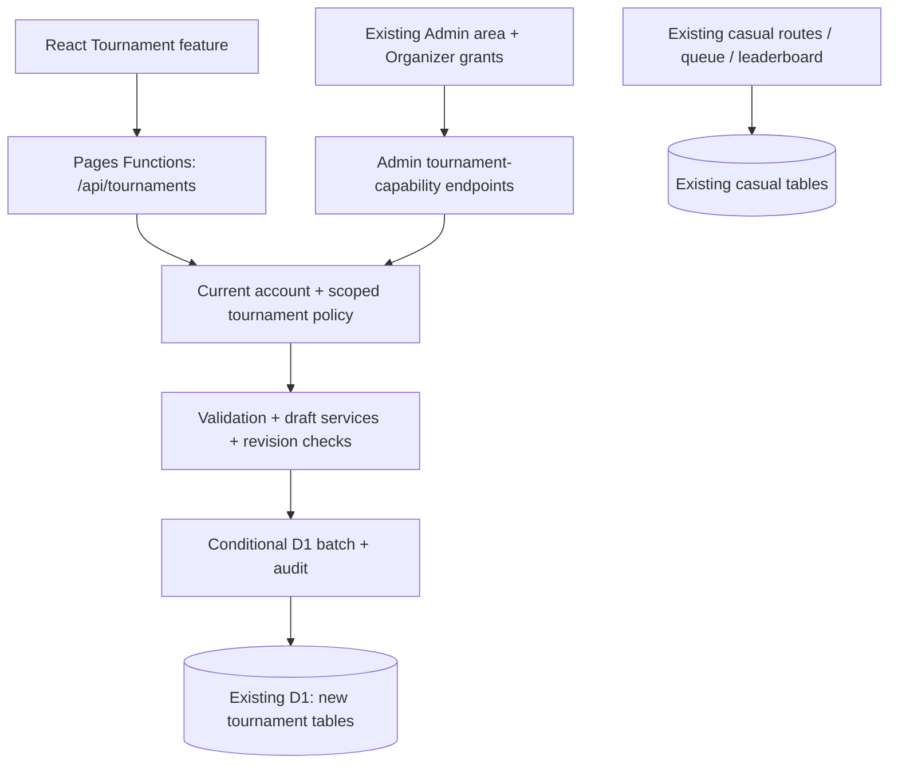

# Tournament module — architecture specification

**Status:** Phase 1 design approved and implemented on an unmerged local branch;
later phases not approved.

**Baseline:** `main` at `c22dce6`; no existing tournament specifications or module found.

Product authority: [PRD.md](PRD.md). Data contract: [DATABASE.md](DATABASE.md).
Review findings, dependencies, test plan and work gates: [TASKS.md](TASKS.md).

## 1. Existing architecture and integration hazards

The application uses React 19, React Router, Vite/PWA, file-based Cloudflare
Pages Functions, and one existing D1 binding. Tests use Node's runner,
SQLite-backed read-route fixtures, Vitest and React Testing Library.

| Existing location | Observation | Tournament dependency |
| --- | --- | --- |
| `functions/api/utils/auth.js` | Accepts only player/supervisor/admin primary roles and trusts JWT role claims. | Do not simply add a new global role string. New tournament authorization must resolve current account/capabilities/assignments. |
| `functions/api/auth/validate.js` | Refreshes user details/approval/ban checks; does not provide Organizer capability data. | Extend the session response compatibly after D-02; protect every new route independently. |
| `src/contexts/AuthProvider.jsx` and navigation/route guards | Primary-role booleans determine casual UI access. | Preserve these meanings; add an independent Organizer capability flag and scoped tournament navigation. |
| `functions/api/utils/courtReset.js` | Deletes unfinished casual matches and rewrites all casual court statuses. | Separate tournament tables now; shared-court reservations/integration must be designed before Phase 4. |
| `functions/api/utils/gameHistory.js` | Casual rankings derive only from completed rows in `matches`. | Do not union tournament matches into casual standings without D-10 approval. |
| `schema.sql` / `migrate_002.sql` … `migrate_008_durable_rate_limits.sql` | Current schema plus manually ordered upgrade files. | Additive next migration; do not rerun historic upgrades on a fresh schema. No production execution during planning. |

## 2. System shape

Reuse the existing hosting/database stack; no purchase or new service is
required for the approved Phase 1 foundation. Resource capacity is not assumed unlimited.
Any later infrastructure proposal needs separate approval.



These are domain boundaries in the same application/database, not independently
deployed microservices. No new SSE fan-out, scheduler, cron or notification
provider is part of Phase 1.

## 3. Identity and authorization proposal — D-02 / D-03

### Recommended representation

Keep `users.role` as player/supervisor/admin. Represent the additional business
role with `user_capabilities(capability = 'tournament_organizer')`. A user can
therefore remain a casual Supervisor and also organize assigned tournaments.

`Tournament Organizer` is the business-role name; the capability table is its
proposed storage mechanism, not an additional unrequested permission tier.
If the owner chooses a different role model, update all four documents first.

Use `tournament_staff` for event-level Organizer/Supervisor assignments.
Capability alone is not ownership of every tournament. `created_by_user_id`
is attribution, not an implicit authorization shortcut.

### New request authorization

1. Verify the existing signed token and expiry; never restore a fallback secret.
2. Load current account eligibility from D1 (approved, non-deleted, non-banned).
3. Resolve the current primary Admin/Supervisor role from D1, not stale claims.
4. Load active Organizer capability and active event assignments as required.
5. Check the requested action, event scope, target parent relationship, and state.
6. Repeat/guard permission-relevant predicates in the mutation protocol to avoid
   a read-check/write race with revocation.

Admin bypasses event assignment, not validation, revision checks or audit.
Assigned Supervisors have read-only draft access in the approved Phase 1 matrix;
court operations arrive in Phase 5. Current players get no draft visibility.

Use 401 for invalid/missing identity, 403 for an action denied on an otherwise
visible resource, and 404 for absent/hidden resources. Configuration failures
retain existing fail-closed 503 behavior. Revoke capability/assignment without
waiting for token expiry; subsequent tournament requests must be denied.

Session/login responses may gain a backwards-compatible `capabilities` array.
Frontend capability caching controls presentation only. Registration endpoints
must not accept a self-selected Organizer/Admin privilege.

## 4. Phase 1 API contract

Final payload fields/limits are frozen in P1-03 after D-01 through D-04 approval.
All endpoints below are authenticated and server-authorized.

| Endpoint | Phase 1 responsibility |
| --- | --- |
| `GET /api/admin/tournament-organizers` | Admin lists current Organizer grants. |
| `PUT /api/admin/tournament-organizers/:userId` | Admin grants/reinstates Organizer capability. |
| `DELETE /api/admin/tournament-organizers/:userId` | Admin revokes capability; no account deletion. |
| `GET /api/tournaments` | Paginated drafts visible to the caller, not an unrestricted event dump. |
| `POST /api/tournaments` | Admin-only draft creation under approved D-01. |
| `GET /api/tournaments/:tournamentId` | Authorized draft detail with revision and allowed actions. |
| `PATCH /api/tournaments/:tournamentId` | Allowlisted metadata update with expected revision. |
| `GET/POST /api/tournaments/:tournamentId/categories` | Read/create category metadata for a visible draft. |
| `PATCH /api/tournaments/:tournamentId/categories/:categoryId` | Edit/disable that draft's category. |
| `GET /api/tournaments/:tournamentId/staff` | Scoped staff view with minimal account fields. |
| `PUT /api/tournaments/:tournamentId/staff/:userId` | Admin replaces that user's allowed event role assignments. |
| `DELETE /api/tournaments/:tournamentId/staff/:userId` | Admin revokes that user's event assignments. |
| `GET /api/tournaments/:tournamentId/audit` | Paginated Admin/assigned Organizer audit view. |

No generic status-transition, publish, registration, bracket, reservation,
schedule or score route is delivered in Phase 1. Client-supplied `status`,
`created_by`, ownership and permission fields cannot change authority.

### Input and mutation rules

- Plain-text descriptions/rules; render as text, not unsanitized HTML.
- Server validates field types, lengths, identifiers, timezone and date pairs.
  Proposed technical bounds: title 160 characters, category label 120,
  description/rules 20,000, JSON request body 64 KiB. Confirm in P1-03.
- Draft dates/deadline may be incomplete; opening registration later requires
  a separate completeness/eligibility check. Do not invent a late-entry policy.
- API timestamps are UTC instants; each event retains its IANA timezone.
- Existing-resource writes provide an expected parent-event revision; stale
  edits return 409 and the UI refetches rather than overwriting another editor.
- Use a stable command/request ID for safe retries and audit attribution;
  fingerprint the normalized mutation payload, not tokens or secrets.
- Perform the mutation and its audit append in a single proven D1 batch.
  Do not treat multiple awaited `run()` calls or JS `Promise.all` as a transaction.
- Parent-child edits must check both IDs; possession of a category ID from a
  different event must never authorize access through the caller's event.
- No generic automatic retry of an uncertain write without its command ID.

## 5. Transaction/concurrency design to prove in Phase 1

D1 `batch` provides atomic execution, but not an arbitrary JavaScript
transaction callback or transactional branching between network requests.

The approved protocol uses conditional DML (including expected event revision
and current authorization predicates), followed by dependent DML/audit that is
conditioned on the same successful command. Immediate SQLite `changes()` guards
are an option only where the full statement chain is demonstrated correct:
no intervening statement/trigger may change the meaning of the guard.

Required properties, not optional implementation preferences:

- A successful event/category/staff command produces one logical audit record.
- A no-op/denied/stale command produces no partial domain update or success audit.
- A SQL constraint/audit failure rolls back the entire command.
- Concurrent same-revision commands have at most one successful writer.
- Replayed command IDs cannot duplicate drafts, grants or audit entries; reuse
  with a different actor/payload is denied.
- Permission revocation cannot be defeated by a stale preflight check.

P1-03 must select and locally prove the exact SQL protocol before mutation routes
are written. A guarded command-record alternative is acceptable only after
updating DATABASE.md and its tests. Do not silently weaken the properties above.

## 6. Prepared repository structure

**Created during planning:** root specifications and documentation-only
`docs/tournaments/`, `docs/tournaments/decisions/`, and
`docs/tournaments/phase-1/` indexes.

**Implemented for approved Phase 1 (uncommitted/unpublished):**

```text
functions/api/tournaments/
  index.js
  [tournamentId]/
    index.js
    categories/index.js
    categories/[categoryId].js
    staff/index.js
    staff/[userId].js
    audit.js
functions/api/admin/tournament-organizers/
  index.js
  [userId].js
functions/api/utils/tournaments/
  policy.js
  validation.js
  repository.js
  audit.js
src/features/tournaments/
  api/
  components/
  hooks/
  pages/
src/features/tournaments/**/*.test.jsx
tests/tournament-*.test.js
tests/helpers/                    # extend existing isolated fixture helpers
migrate_009_tournament_foundation.sql
schema.sql                       # updated for Phase 1
```

Match Pages Functions file routing conventions; do not put domain/service code
into a route file solely to share it. Keep dependencies one-way: route → policy
/ service → repository; the UI uses API contracts, never D1 bindings.
The migration number must be rechecked for collisions before any later migration.

## 7. Phase 1 frontend

- Scoped tournament draft list; Admin draft-creation action.
- Draft editor for BR-06 metadata and categories, with explicit saved/draft state.
- Admin Organizer grants and event staff assignment controls.
- Organizer assigned-event editing; assigned Supervisor read-only view.
- Independent loading, error, empty, validation, and stale-edit recovery states.
- Keyboard/label accessibility and responsive layout.
- Add scoped module navigation without changing existing casual-role shortcuts.
- Do not show enabled registration/publish/draw/schedule/score buttons that do
  not exist. No mock functionality presented as working features.

No private staff/registration responses are persisted in PWA caches or offline
write queues. Reuse authenticated API clients and no-store responses.

## 8. Later-phase dependencies (design only)

- **Phase 2:** approved eligibility, partnership/deadline policy, public visibility,
  entry lists, and category/event state model.
- **Phase 3:** approved formats, seeds/byes, draw versioning, withdrawal/replacement
  rules, deterministic generation and publication.
- **Phase 4:** court reservation authority consulted by casual and tournament
  starts, cross-category player conflicts, rest intervals and rescheduling.
  Merely copying court status into a tournament table is insufficient.
- **Phase 5:** idempotent results/bracket advancement, corrections when downstream
  matches have started, match concurrency, and live schedule delivery.
- **Phase 6:** approved announcements/results/winner publication and retention.

The casual daily reset must never remove tournament data or invalidate actual
tournament reservations. If casual availability is adapted later, preserve the
queue/check-in business rules and test the integration before enabling schedules.

## 9. Operational boundaries

No new infrastructure, remote migrations, production deploy commands, production
fixtures, credential changes or automatic merge/deploy actions in Phase 1.
Local tests use isolated data and ephemeral development credentials only.
Future review branches may trigger Cloudflare previews; publishing a branch/PR
and using a preview require explicit agreement on environment/data isolation.
Production approval is a separate gate even when all checks pass.
