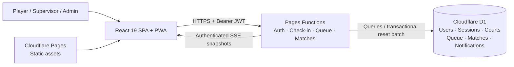

# Pickleball Courts

**From QR check-in to the next match—court operations in one place.**

[](https://github.com/Developits/pickleball-courts/actions/workflows/validate.yml)


[](LICENSE)

[**Live app →**](https://pickleball-courts-d39.pages.dev) · [Report a bug](https://github.com/Developits/pickleball-courts/issues)

A full-stack application for college pickleball sessions: supervisors open
courts, players scan a short-lived QR code and join a queue, and matches feed
into scoring and player statistics. React runs on Cloudflare Pages; Pages
Functions handle the API against a D1 SQLite database.

> **Demo access:** the landing page is public. Player dashboards require an
> account approved by an administrator; supervisor/admin access is not shared.
> This is a hosted app, not an anonymous, disposable sandbox. Do not submit
> sensitive information just to explore it.

## What it demonstrates

- **Role-based workflows:** separate player, supervisor, and admin dashboards,
  backed by server-side authorization.
- **QR check-in:** short-lived tokens with player identity taken from the
  authenticated session, not a client-supplied user ID.
- **Session-aware scheduling:** closed-court checks, queue locking, weighted
  waiting-player priority, and automatic match assignment.
- **Live updates:** authenticated SSE streams deliver court, queue, match, and
  check-in snapshots; the frontend handles split network frames and reconnects.
- **State cleanup:** daily reset uses a D1 transactional batch to close the
  session before clearing active court state.
- **Installable frontend:** PWA manifest and service worker, without pretending
  offline clients can safely mutate shared court state.

## Architecture



SSE currently polls D1 every two seconds **per connection**; it is not a
Durable Objects event bus. Database bindings and JWT secrets stay on the
server. No separate Node application server is required.

### Session flow

```text
Admin approves account
  → Supervisor opens court session and generates QR
  → Player scans QR and joins queue
  → Supervisor assigns or auto-assigns a match
  → Supervisor records a result; player statistics update
  → Supervisor closes session / Admin resets active state
```

## Roles

- **Player:** scans the supervisor QR code, joins the queue, and views stats.
- **Supervisor:** opens/closes the court, generates QR codes, assigns matches,
  records scores, and cancels unfinished matches.
- **Admin:** approves registrations, manages users, and can perform a daily reset.

There are no default privileged credentials. New registrations remain pending
until an admin approves them.

### Signed-in home and match center

Signed-out visitors see the public landing page. After login, `/` shows a
personalized member home with court availability, completed-match statistics,
recent personal results, and shortcuts appropriate to the user's role.

The game-history page supports direct links to
`/game-history?tab=live`, `?tab=leaderboard`, and `?tab=history&scope=mine`.
Live matches load over REST immediately and then update through SSE, with a
30-second refresh fallback when the stream is disconnected. History supports
all-club/personal filtering and paginated loading. Failures show retry controls,
not misleading empty-result messages.

Leaderboards derive statistics from completed, non-deleted match records,
not cached user counters. Rankings sort by win rate, then wins, with stable
name/ID tie-breakers. Wins earn two points; draws count toward matches played
but not wins or losses. Unplayed, unapproved, and deleted accounts do not rank.

## Stack

- React 19 and Vite
- Cloudflare Pages Functions
- Cloudflare D1 (SQLite)
- Tailwind CSS
- Server-Sent Events for live court, queue, match, and check-in updates
- Node's built-in test runner

## Prerequisites

- Node.js 24 or newer (CI uses Node 24)
- npm
- A Cloudflare account for D1 and deployment

Install dependencies:

```bash
npm ci --ignore-scripts
```

## Local Configuration

Create `.dev.vars` in the project root:

```dotenv
JWT_SECRET=replace-with-a-random-secret-at-least-32-characters-long
```

`.dev.vars` is ignored by Git. Never commit JWT secrets or production
credentials.

Generate a random secret rather than using the example literally:

```bash
node --input-type=module -e "import { randomBytes } from 'node:crypto'; console.log(randomBytes(32).toString('hex'))"
```

Authentication returns **503** when `JWT_SECRET` is missing, blank, or shorter
than 32 characters. There is no development fallback key.

Create the D1 database if needed:

```bash
npx wrangler d1 create pickleball-courts
```

Copy the returned database ID into `wrangler.toml`.

### New Database

Initialize a new local database from the current schema:

```bash
npx wrangler d1 execute pickleball-courts --local --file=./schema.sql
```

For a new remote database, replace `--local` with `--remote`.

### Existing Database

Run only pending migrations, in numeric order. The current migration chain is:

```text
migrate_002.sql
migrate_003.sql
migrate_004.sql
migrate_005_court_sessions.sql
migrate_006_remove_geofence.sql
migrate_007_remove_hard_sit_out.sql
migrate_008_durable_rate_limits.sql
```

Example:

```bash
npx wrangler d1 execute pickleball-courts --local --file=./migrate_008_durable_rate_limits.sql
```

Do not run historical migrations after `schema.sql` on a new database; the
schema already contains their final state.

## Privileged Accounts

For local development, create accounts with bcrypt-hashed passwords:

```bash
node create-admin.js admin002 "StrongPassword" "Admin Name"
node create-supervisor.js supervisor002 "StrongPassword" "Supervisor Name"
```

These scripts target the local D1 database and do not print passwords or raw
SQL.

For production, register an account normally, then promote and approve it from
an authenticated Cloudflare/Wrangler session:

```bash
npx wrangler d1 execute pickleball-courts --remote --command "UPDATE users SET role = 'admin', is_approved = TRUE WHERE student_id = 'YOUR_ID'"
```

Use `role = 'supervisor'` for a supervisor account.

## Development

```bash
npm run dev
```

The command builds the frontend and starts Wrangler Pages development with the
local D1 binding. Wrangler prints the local URL.

Available commands:

| Command | Purpose |
| --- | --- |
| `npm run dev` | Build and run Pages Functions locally |
| `npm run build` | Create the production frontend build |
| `npm run lint` | Lint application, Functions, scripts, and tests |
| `npm test` | Run focused API and utility tests |
| `npm run test:api` | Run Node API tests, including real SQLite match-center queries |
| `npm run test:ui` | Run React UI and asynchronous resource tests with Vitest |
| `npm run test:watch` | Watch React UI tests |
| `npm run test:api:watch` | Watch API and utility tests |
| `npm run check:functions` | Compile Pages Functions locally without deploying |
| `npm run check` | Run lint, tests, frontend build, and Functions compilation |
| `npm run preview` | Preview static assets only; this does not run the API |
| `npm run deploy` | Build and deploy to Cloudflare Pages |

Run the full quality gate before deployment:

```bash
npm run check
npm audit
```

GitHub Actions runs these gates on pushes and pull requests. Tests exercise
authentication and token expiry, court/queue guards, match creation, reset
ordering, persistent rate limits, SSE framing, stream cleanup, and Shanghai
date boundaries. Match-center read routes execute against an in-memory SQLite
schema; other operational route tests use mocked D1 adapters. React tests cover
member routing, role shortcuts, tab navigation, pagination, retries, refreshes,
and stale-response handling. This is not a claim of end-to-end production or
concurrency verification.

Wrangler is pinned in the lockfile instead of relying on a globally installed
CLI. The Workbox `glob` dependency has a targeted patched-version override;
the PWA build is checked alongside the rest of the app. Revisit the override
when upstream Workbox adopts a patched dependency.

## Security boundaries

- Passwords use bcrypt hashes; registrations require admin approval.
- JWTs use HS256 with Web Crypto verification, required expiry, and validated
  user IDs and roles. All authentication paths require a configured secret.
- SSE accepts Authorization headers, not credentials embedded in URLs; streams
  stop on cancellation, request abort, or token expiry.
- Rate-limit counters persist in D1 rather than per-Worker memory.
- The frontend stores a bearer token in local storage. XSS could expose it;
  the login response's HttpOnly cookie is not a cookie-only session design.
- Tokens do not implement immediate revocation. Review account-change and
  session-management requirements before deploying beyond a trusted group.

These are implemented controls, not a security certification.

## Core Operational Rules

- Player check-in is QR-only; geofencing is not used.
- QR validation derives the player identity from the authenticated JWT.
- A court session must be open before check-in, queue join, or match creation.
- Queue lock prevents new joins near closing time but does not block assigning
  players who are already waiting.
- Player match/win/loss counters update only after a scored match is completed.
- Canceled or reset unfinished matches are removed and do not affect stats.
- API rate limits are stored in D1, so counts survive Worker instance changes.

## Notifications

The application currently provides authenticated in-app notifications stored
in D1 and live dashboard refreshes through SSE.

Browser push is intentionally not enabled yet. A production push rollout needs
a VAPID key pair, permission UX, subscription lifecycle endpoints, provider
delivery/retry handling, and secret configuration. The existing
`push_subscription` field is reserved for that future integration.

## Deployment

1. Update the D1 `database_id` in `wrangler.toml`.
2. Run pending migrations against the remote database.
3. Configure the production JWT secret for the correct **Pages project**:

   ```bash
   npx wrangler pages secret put JWT_SECRET --project-name YOUR_PAGES_PROJECT
   ```

   Configure preview secrets separately if using Cloudflare preview deployments.
   Do not paste secret values into GitHub issues or commit them to the repo.
   Before rolling out the authentication changes, confirm a real random secret
   is configured: missing/short secrets now stop authentication with 503.
   If the old fallback key was ever used, replace it; existing sessions will
   need to sign in again.
4. Run `npm run check` and `npm audit`.
5. Check that the Pages project name, D1 binding, and environment are correct;
   then deploy with `npm run deploy`, or use your configured Pages Git integration.

### Scheduled court closing

`functions/scheduled/auto-close-court.js` contains an auto-close routine, but
this repository does **not** provision a scheduled Worker. A directory named
`scheduled` does not register a Pages Cron Trigger. To automate closing, wire
the routine into a separate Worker with a scheduled handler, the same D1
binding, and a `0 13 * * *` cron (21:00 Asia/Shanghai). Until that is deployed
and verified, use the authenticated supervisor/admin close/reset workflows.

## Current limitations

- No public role-switching demo or read-only seeded dashboards.
- SSE polling scales database reads with connected clients; load testing and
  event-driven fan-out remain future work.
- Browser push notifications are not implemented.
- Scheduled closing needs the separate deployment described above.
- API tests are focused regressions, not a full browser/D1 integration suite.
- Court allocation heuristics are configurable rules, not a proven fairness
  guarantee or a full tournament-bracket engine.

The older [PROJECT_AUDIT.md](PROJECT_AUDIT.md) is historical context. Its
production-readiness percentages are not a current assessment; use the
documented limitations and reproducible checks instead.

## Tournament module — Phase 1 implementation

The separate tournament module is specified in
[PRD.md](PRD.md), [ARCHITECTURE.md](ARCHITECTURE.md),
[DATABASE.md](DATABASE.md), and [TASKS.md](TASKS.md).

Phase 1 (Admin-created drafts, Organizer capability/staff assignments, category
metadata and audit) is implemented on `feat/tournament-phase-1` and published as
draft PR #3. It is not merged or deployed to production. Registration, draws,
scheduling, scoring, publication and production rollout remain unimplemented
and require separate approval. Existing casual court workflows are unchanged.

## Project Layout

```text
src/                 React application
functions/api/       Cloudflare Pages API routes
functions/scheduled/ Auto-close routine (requires separate scheduled deployment)
tests/               Node API and utility tests
schema.sql           Source of truth for new databases
migrate_*.sql        Ordered migrations for existing databases
wrangler.toml        Cloudflare Pages and D1 configuration
.github/workflows/   Lint, tests, dependency audit, and build checks
```

## License

[MIT](LICENSE) © 2026 ISLAM MD NAHIDUL.
